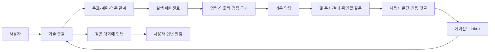

# Workflow

여러 AI 에이전트와 진행한 일을 **계획 → 실행 → 근거 → 사용자 의견 → 후속 작업**으로 연결하는 작은 로컬 웹 작업공간입니다. 프로젝트마다 데이터 폴더를 나누고, 총괄 에이전트와 실행·기록 담당이 같은 기록을 읽습니다.

사용자는 웹에서 확인할 결과와 질문을 보고, 문서의 특정 문단이나 드래그한 구절에 메모를 남깁니다. 에이전트는 다음 실행 전에 새 의견을 읽고, 실제 변경에는 근거를, 나중에 할 일에는 계획 노드를 연결해 답합니다. 답변 알림의 **사용자 읽음**과 **에이전트 처리 완료**를 별도로 저장합니다.

이 저장소는 연구 프로젝트에서 사용하던 운영 방식을 독립적인 최소 코어로 재구현한 초기 버전입니다. 원래 프로젝트의 데이터·계정·실행 환경을 포함하지 않습니다. 원 제품의 모든 기능을 그대로 옮긴 배포판은 아닙니다.

## 빠르게 시작하기

Python **3.10 이상**, Linux 또는 macOS가 필요합니다. Python 패키지 설치와 프런트엔드 빌드가 필요 없습니다. Chrome·Firefox·Safari 등 최신 브라우저를 사용합니다.

```bash
git clone https://github.com/kwonminki/workflow.git
cd workflow

# 합성 예제가 있는 새 작업공간. 기존 데이터는 덮어쓰지 않습니다.
python3 -m workflow --data ./demo-workspace init --title 'My project' --demo
python3 -m workflow --data ./demo-workspace serve --port 8040
```

브라우저에서 `http://127.0.0.1:8040`을 엽니다. 빈 작업공간은 `--demo`를 빼고 생성합니다. 모든 CLI 명령은 이 저장소 폴더에서 실행하고 같은 `--data`를 전달합니다. 다른 위치에서 실행하려면 이 저장소를 `PYTHONPATH`에 지정합니다.

맥에서 원격 서버의 작업공간을 볼 때:

```bash
# 서버에서 위 serve 명령을 실행한 뒤, 맥의 별도 터미널에서
ssh -N -L 8040:127.0.0.1:8040 <user>@<server>
```

맥 브라우저도 `http://127.0.0.1:8040`으로 접속합니다. 서버는 기본적으로 loopback에 바인딩합니다. 인증·사용자별 권한이 없는 개인/신뢰된 로컬 작업공간이며, 공개 인터넷용 서비스가 아닙니다. 포트를 다르게 전달한다면 브라우저의 Host와 서버 포트가 일치하도록 **양쪽 포트를 같은 값**으로 바꾸세요.

### 원하는 포트·자동 빈 포트·내부망 접속

8040을 고정으로 쓸 필요는 없습니다. 원하는 빈 포트를 지정하거나 `--port 0`으로 운영체제가 빈 포트를 선택하게 할 수 있습니다. 실제 주소는 시작 로그에 출력됩니다.

```bash
python3 -m workflow --data ./demo-workspace serve --port 18743
python3 -m workflow --data ./demo-workspace serve --port 0

# 같은 내부망의 다른 컴퓨터에서 직접 접속: 서버의 실제 LAN IP 사용
python3 -m workflow --data ./demo-workspace serve --host 192.168.1.20 --port 18743
```

마지막 예시에서는 맥/다른 PC 브라우저에서 `http://192.168.1.20:18743/#`로 접속합니다. 예시 IP를 **서버의 실제 내부 IP**로 바꾸세요. `--host 0.0.0.0`도 지원하며, 브라우저에는 0.0.0.0 대신 실제 내부 IP를 입력합니다. 방화벽은 해당 포트를 신뢰된 내부망에만 허용합니다. 인터넷 포트포워딩은 하지 않습니다. 내부망 접근이 안 되는 환경에서는 위 SSH 터널 방식을 사용합니다. SSH 터널도 선택한 포트를 양쪽에서 동일하게 지정하세요.

## Discord 알림·메인 세션 연결 (선택)

[Discord 에이전트 봇](https://github.com/kwonminki/ai-agent-discord-connector)을 함께 설치하면 여러 프로젝트의 Codex/Orca 세션을 Discord에서 관리하기 편합니다. **[설치 권장 사항과 실제 연결 절차](docs/SESSION_BRIDGE.md)**에 봇 설치 안내, 메인 세션 UUID 지정, 새 알림 스레드 생성, worker 상시 실행, 세션 교체/복구를 정리했습니다.

연동을 켜면 `지금 확인`의 새 확인 요청/새 버전을 전용 Discord 스레드로 알리고, 웹 오른쪽 위 **메인 세션에 완료 전달하기**로 보고 있던 페이지를 기존 메인 세션에 전달합니다. 별도 worker가 필요하며 기본 설치는 외부 메시지를 보내지 않습니다. 알림 전용 스레드와 기존 세션의 대화 스레드는 구분합니다. 입력 수락은 에이전트의 검토 완료를 뜻하지 않습니다.

## 기본 작업 순환



1. **총괄**은 목표를 작은 작업으로 나누고, 담당 역할·다음 행동·선행 작업·완료 조건을 기록합니다. 사람 담당자를 추측해서 배정하지 않습니다.
2. **실행 에이전트**는 `inbox --require-clear`로 새 의견을 먼저 읽고 `run`으로 로컬 명령을 실행합니다. 실행 성공과 업무 완료는 별개입니다.
3. **기록 담당**은 목적, 시도, 실제 결과, 검증 범위, 판단, 남은 일을 문서에 적습니다. 결과 파일은 실행 기록에 연결합니다.
4. **사용자**는 `지금 확인`에서 명시적인 확인 요청만 봅니다. 문서에서 문단을 클릭하거나 한 문단 안의 글을 드래그해 `+ 메모`를 누릅니다.
5. **총괄/담당**은 인용 버전과 전체 대화를 읽습니다. 완료한 변경은 `applied + evidence`, 후속 계획은 `deferred + workflow_node`, 읽기만 한 것은 `seen`으로 답합니다. `seen`은 새 실행을 허용하는 처리 완료가 아닙니다.
6. **사용자**는 기본 안 읽음 답변함에서 답을 봅니다. 답변을 열면 해당 답변만 읽음 처리됩니다. 같은 대화의 다른 새 답변은 남고, `이전 알림으로 가기`로 방금 연 대화를 다시 볼 수 있습니다.

에이전트 실행·재개·전달은 사용하는 오케스트레이터나 사람이 수행합니다. 기본 웹은 에이전트를 자동 시작하지 않습니다. 선택 연동의 명시적 버튼으로 이미 실행 중인 Orca/Codex 세션에 확인 요청을 보낼 수 있습니다.

## 제공하는 핵심 기능

| 기능 | 현재 동작 |
| --- | --- |
| 작업 흐름 | 모든 계획 노드를 의존 관계에 따라 SVG 그래프로 표시, 확대/축소, 연결 강조, 상세 수정. 그룹명·우선순위·담당·다음 행동 저장 |
| 사용자 확인함 | `review` 상태 작업만 표시. 자료가 있다는 이유로 검수를 요구하지 않음 |
| 실행 기록 | 로컬 CLI로 argv·cwd·입출력 경로·시작/종료·exit code·담당 세션 기록. 16 MiB 이하 출력 파일의 SHA-256 기록 |
| 문서 | CLI로 일반 텍스트 본문 등록, 문서 SHA와 이전 버전 보존, 최신 수정순 목록 |
| 문맥 있는 댓글 | 문단 전체 또는 같은 문단 내 드래그 구절, Unicode codepoint 위치·인용문·앞뒤 문맥·문서 버전 저장 |
| 형광 표시 | 현재 버전의 정확한 인용 위치에 표시. 겹친 댓글은 선택 목록, 이전 버전 댓글은 이력으로 보존 |
| 답변과 알림 | 같은 대화의 후속 의견, 기본 안 읽음/전체 보기, 해당 답변 읽음, 정확 인용으로 이동, 방금 열었던 대화 복귀 |
| 에이전트 기록 | 역할·세션을 등록하고 기록 당시 값 저장. 세션을 갱신해도 과거 작성자 정보는 유지 |
| 저장 충돌 방지 | 프로젝트별 JSON, 로컬 POSIX 파일 잠금, 원자적 교체, 웹 revision 충돌 거부, 변경 이벤트 이력 |
| 갱신 | 열린 편집/메모 창과 텍스트 선택이 없을 때 15초 간격 새 revision 확인 |

### 현재 범위 밖

- Notion/Linear API 연결, 양방향 동기화, 웹훅, 일반 작업 스케줄러, 새 에이전트 자동 기동 (선택 Orca 세션 전달은 제공)
- 일반 Markdown 렌더링, 이미지/영상 업로드·샘플 검수 플레이어, 임의 로컬 파일 서빙
- 그래프 그룹 접기·캔버스 드래그 편집·자원 스케줄링, 여러 문단을 가로지르는 선택 댓글
- 변경된 문서에서 옛 댓글 위치를 추정해 자동 재부착하는 기능
- 사용자별 계정/권한/읽음, 조직 공동 편집, 분산 스토리지, 대규모 DB, Windows
- 전역 명령 감시·전체 패키지/모델 환경 수집·stdout/stderr 자동 저장

답변의 `evidence`는 링크/경로 **참조**입니다. 이 코어가 파일 내용이나 외부 링크의 타당성을 인증하지 않습니다. `done`에는 완료 이유와 근거를 요구하지만 실제 수락 판단은 담당 총괄이 합니다.

## 에이전트가 쓰는 CLI

모든 예시는 합성 데이터입니다. JSON을 표준입력(`--file -`) 또는 파일(`--file action.json`)로 넘길 수 있습니다. 프로젝트 데이터 위치를 실수하지 않도록 명시합니다.

```bash
export WORKFLOW_DATA="$PWD/demo-workspace"
python3 -m workflow inbox --require-clear

# 세션을 새로 시작했을 때 등록/갱신
python3 -m workflow apply agent --file - <<'JSON'
{"id":"worker","role":"Implementation","session":"your-actual-session-id"}
JSON

# 실제 명령을 실행하고 기록 (shell 해석 없이 argv로 실행)
python3 -m workflow run --node implementation --agent worker \
  --summary '작은 출력 한 건의 생성 확인' --cwd . --output demo-workspace/result.txt \
  -- python3 -c 'from pathlib import Path; Path("demo-workspace/result.txt").write_text("example result\n")'
```

명령의 출력은 터미널에 그대로 나오고 이 코어가 별도 로그 파일에 저장하지 않습니다. 토큰·비밀번호를 명령 인자에 넣지 마세요. **명령 인자는 원문 그대로 기록**됩니다. 필요한 stdout/stderr 파일은 실행 코드에서 명시적으로 만들고 `--output`에 등록합니다. 로그에 비밀 값이 없는지 먼저 확인합니다. 환경변수 전체는 수집하지 않습니다.

실행 전 미처리 사용자 의견이 있으면 `run`이 시작을 거부합니다. 새 댓글이 도착했다고 이미 실행 중인 명령을 중단하지 않습니다. 강제 종료/전원 차단 시 `running` 기록이 남을 수 있으며 자동 복구나 재실행을 하지 않습니다. 원래 작업을 기록 도구 때문에 잃지 않도록 필요한 경우 원래 실행 방식과 `apply run` 사후 기록을 사용하고 누락 범위를 적습니다.

```bash
# 보고 문서: UTF-8 JSON의 body에 본문을 넣습니다.
python3 -m workflow apply document --agent worker --file examples/document.json

# 해당 웹 문서에서 메모를 남긴 뒤, 정확 thread/message ID와 문맥 확인
python3 -m workflow inbox --require-clear

# 아래 placeholder는 실제 inbox의 ID로 바꿉니다.
python3 -m workflow apply reply --agent worker --file - <<'JSON'
{"thread_id":"thread-REPLACE","reply_to":"message-REPLACE","text":"요청한 설명을 수정했습니다. 연결 문서에서 변경을 확인할 수 있습니다.","outcome":"applied","evidence":["#document/example-design"]}
JSON
```

나중에 할 일은 먼저 실제 노드를 만든 후 연결합니다.

```bash
python3 -m workflow apply node --agent coordinator --file examples/followup-task.json
python3 -m workflow apply reply --agent coordinator --file - <<'JSON'
{"thread_id":"thread-REPLACE","reply_to":"message-REPLACE","text":"입력 계약 확정 후 별도 검증이 필요하여 후속 작업에 등록했습니다.","outcome":"deferred","workflow_node":"followup-validation","evidence":["#graph"]}
JSON
```

`deferred`는 실행 완료가 아닙니다. 등록한 계획에 다음 행동·의존 조건·담당을 남기고 실제 재개 여부를 따로 관리합니다. 전체 JSON은 `python3 -m workflow state`로 내보낼 수 있습니다. CLI action 목록은 `python3 -m workflow apply --help`에서 확인합니다.

## 다른 프로젝트에 적용하기

1. 프로젝트별 데이터 폴더를 만들고 새 `init`을 실행합니다. 테스트에는 운영 데이터 경로를 쓰지 않습니다.
2. 역할/실제 세션을 등록하고 목표·입출력 계약·완료 조건을 계획 노드에 추가합니다.
3. 프로젝트의 기존 에이전트 지침에 [에이전트 운영 규약](docs/AGENT_PROTOCOL.md)의 진입 명령을 추가합니다. 기존 지침 전체를 덮어쓰지 않습니다.
4. 작업 기록과 문서를 등록하고 사용자가 결과를 볼 수 있는 링크를 근거에 넣습니다.
5. Notion/Linear를 쓰면 [연동 경계와 확장](docs/INTEGRATIONS.md)에 따라 요약·외부 링크·동기화 영수증을 별도로 설계합니다.

핵심 작업 데이터는 지정 폴더의 `state.json`과 `.lock`에 저장합니다. 선택 세션 연동은 별도 비공개 설정 경로에 전송 영수증과 잠금 파일을 저장합니다. JSON에는 실행 경로·명령·사용자 댓글 등이 포함되므로 공개 저장소에 커밋하지 않습니다. 기본 경로와 예제 경로는 `.gitignore`에 들어 있습니다. **임의로 지정한 데이터 폴더도 반드시 ignore하거나 저장소 밖에 두세요.** 백업은 작업 중 원자적으로 교체되는 `state.json` 한 파일을 복사하면 됩니다. 복구할 때는 서비스와 기록 CLI를 멈춘 상태에서 복사본을 별도 폴더에 두고 먼저 검증합니다. SQLite나 데이터 마이그레이션은 아직 제공하지 않습니다.

로컬 디스크에서 POSIX 잠금과 atomic rename을 전제로 합니다. NFS/SMB 및 여러 호스트의 동시 작성은 검증하지 않았습니다. 각 변경 때 전체 JSON을 쓰므로 대규모 이력 서비스로 운영하기 전 DB 저장 계층으로 바꾸는 것이 필요합니다.

## 검증

```bash
python3 -m unittest discover -s tests -v
node --check workflow/static/app.js  # Node가 설치된 경우 JavaScript 구문 검사

# 선택: Node 22+와 Chromium이 있는 환경의 실제 브라우저 검사
CHROME_BINARY=/path/to/chromium \
WORKFLOW_BROWSER_OUTPUT=/tmp/workflow-browser-evidence \
node tests/browser-smoke.mjs
```

테스트는 임시 작업공간을 생성하고 계획 사이클/누락 참조, revision 충돌, 동시 기록, 실제 명령 성공·실패, 댓글 처리 gate, 새 후속 의견, 읽음과 처리 분리, 이모지 인용, 과거 문서/작성 세션 보존을 검사합니다. socket 없는 HTTP handler 검사도 수행합니다. 실제 TCP HTTP 통합 검사는 로컬 socket 생성이 가능한 환경에서만 실행됩니다. 환경이 socket을 막으면 skip으로 표시되며 HTTP 검증 성공으로 보고하지 않습니다.

## 파일 지도

```text
workflow/
├── README.md
├── AGENTS.md                 # 이 코드 저장소의 작업 규칙
├── docs/
│   ├── AGENT_PROTOCOL.md     # 다른 프로젝트에 적용할 작업 순환
│   ├── DATA_MODEL.md         # 필드·상태·충돌·이력 의미
│   └── INTEGRATIONS.md       # Notion/Linear/오케스트레이터 연결 경계
├── examples/                # 합성 JSON 입력 예제
├── workflow/
│   ├── __main__.py          # init/serve/apply/inbox/run/state
│   ├── store.py             # 검증·상태 전이·잠금·원자적 저장
│   ├── server.py            # 로컬/신뢰된 내부망 API, 정적 allowlist
│   ├── demo.py              # 합성 예제
│   └── static/              # 빌드 없는 HTML/CSS/JavaScript
└── tests/
```

라이선스는 저장소 소유자의 결정을 따릅니다. 이 초기 전달본은 임의의 오픈소스 라이선스를 새로 부여하지 않습니다. 외부 재배포 전에 저장소의 최신 LICENSE와 소유자 정책을 확인하세요.

초기 전달 시점의 실제 통과/skip/미검증 범위는 [검증 기록](docs/VERIFICATION.md), 원격 연결 복구 후 통합 절차는 [게시 안내](docs/PUBLISHING.md)에 있습니다.
